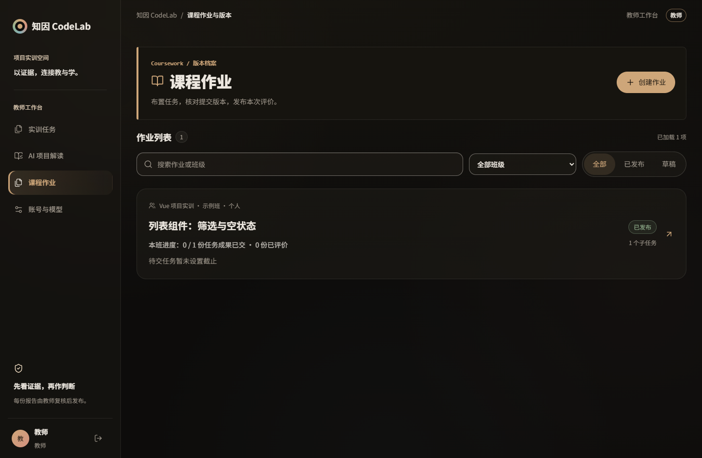

# 知因 CodeLab

**面向编程实训的作业提交与辅助评阅工作台。** 学生提交的是固定版本的代码；教师点开一条反馈，看到的是这次提交的文件和行号，而不是学生后来改过的分支。AI 可以帮忙找证据，但不能替教师发布结论。

[开始使用](docs/QUICKSTART.md) · [本地环境](docs/REPRODUCE.md) · [模型配置](docs/MODEL_SETUP.md) · [工程记录与验收边界](ENGINEERING-NOTES.md)



## 跟着一次作业看项目

1. **布置任务。** 教师把练习拆成独立或连续的子任务，设定截止时间与允许的提交来源。
2. **固定版本。** 学生准备代码片段、文件、ZIP 或公开 Git 仓库内容，再确认提交。Git 导入绑定到具体提交，不跟随分支漂移。
3. **核对反馈。** 教师从评语定位到当次提交的源码行，上下对照后采用、修改或自行填写反馈。学生的私下自查不等于正式评价。
4. **发布与复提。** 教师确认发布后，学生查看反馈并提交下一版。没有模型密钥也能提交和人工评阅。

| 入口 | 适合做什么 | 不代表什么 |
| --- | --- | --- |
| 课程作业 | 提交作业快照，按版本评阅 | 不会执行任意学生代码 |
| 实训任务 | 开放项目交流；对获准的固定 Vue 模板样本运行浏览器检查 | 模板检查结果不能推广到所有项目 |
| AI 项目解读 | 静态阅读普通项目，按引用核对源码 | 静态推断不是运行结果 |

## 工程设计

| 模块 | 技术与职责 |
| --- | --- |
| [师生工作台](apps/web/src) | Vue 3、TypeScript、Pinia。桌面并排阅读引用，窄屏弹窗核对；写入回执不确定时先对账，不盲目重发。 |
| [业务 API](apps/api/src) | Fastify、PostgreSQL。处理账号权限、提交快照、后台任务与教师发布。 |
| [受限 Agent](apps/api/src/agent-v2.ts) | LangGraph 按检查结果选择有限工具，约束调用次数和 Token 预算；模型失败仍可查看基础报告。 |
| [执行器](apps/runner) | 对已获准的开发样本，在受控环境构建并采集浏览器证据。与普通项目的静态阅读分开。 |

**一个实际修复：** 同一出口 IP 下，50 个模拟学生共用写额度，第一轮提交成功、第二轮上传全部触发 429。改为已认证请求按账号计数、登录仍按 IP 限流后，本机两轮提交及教师发布流程的 350 次写请求全部通过。这是开发回归，不是真实课堂容量指标。

## 本地体验

使用仓库指定的 pnpm 版本安装依赖；Windows 推荐 Node.js 24.19.0。以下命令仅启动网页，可直接浏览公开介绍，不提供登录服务：

```sh
pnpm install --frozen-lockfile
pnpm --filter @codelab/web dev --port 5180
```

打开 [本机项目介绍](http://127.0.0.1:5180/welcome)。需要实际登录、提交与发布时，按[环境复现](docs/REPRODUCE.md)配置服务，再跟随[师生操作路线](docs/QUICKSTART.md)。无需为了浏览介绍或人工评阅配置付费模型。

## 验证范围

仓库包含 [Vitest 与 Playwright 测试](tests)及[模型评测协议](eval)。构造样本与真实教学质量分开判断：10 次真实模型开发请求中，8 份通过结构校验、2 份被拦截；格式合规不等于教学意见正确。真实教师抽评、课堂成效和生产环境隔离仍需独立验收。历史测试次数、运行条件和恢复记录见[工程笔记](ENGINEERING-NOTES.md)。
